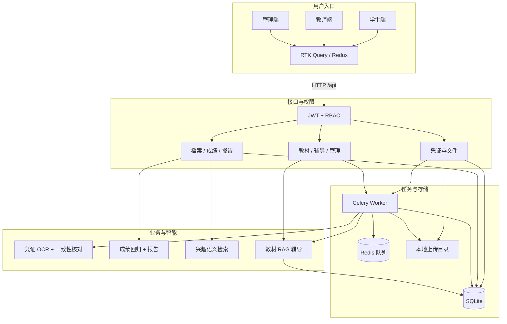
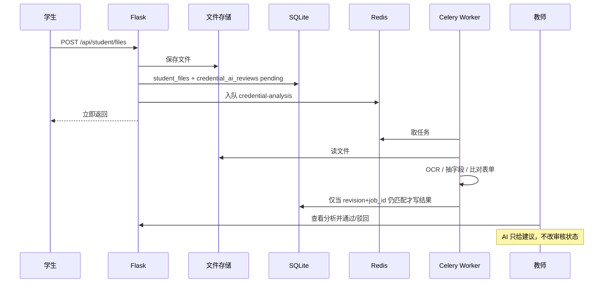
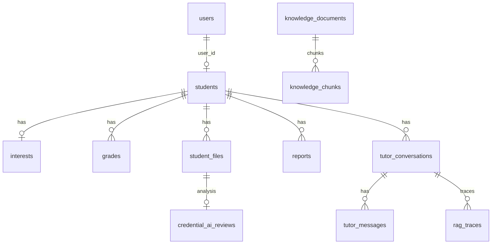

<!-- Generated by SpecStory, Markdown v2.1.0 -->

# 2026-09-11 02:24:57Z

<!-- Cursor IDE Session e0f5ab76-f4ad-41c8-82ed-02c58e945e2a (2026-09-11 02:24:57Z) -->

_**User**_

这个项目的redis在做什么？

---

_**Agent (grok-4.6)**_

<think><details><summary>Thought Process</summary>
正在分析这个项目中 Redis 的具体用途。

已确认这是 student-growth-system 项目，正在代码库中查找 Redis 的具体用法。
</details></think>

_**Agent (grok-4.6)**_

我先在项目里搜 Redis 的配置和调用点，确认它实际承担哪些职责。

_**Agent (grok-4.6)**_

<tool-use data-tool-type="unknown" data-tool-name="get_mcp_tools"><details>
<summary>Tool use: **get_mcp_tools**</summary>

Parameters:

```json
{
  "server": "cursor",
  "toolName": "Task"
}
```
Result:

```json
{
  "content": "{\n  \"tool\": \"Task\",\n  \"description\": \"Launch a new agent to handle complex, multi-step tasks autonomously.\\n\\nThe Task tool launches specialized subagents (subprocesses) that autonomously handle complex tasks. Each subagent_type has specific capabilities and tools available to it.\\n\\nWhen using the Task tool, you must specify a subagent_type parameter to select which agent type to use.\\n\\nIf the query is a narrow or specific question, you should NOT use the Task and instead address the query directly using the other tools available to you.\\n\\nExamples:\\n- user: \\\"Where is the ClientError class defined?\\\" assistant: [Uses Grep directly - this is a needle query for a specific class]\\n- user: \\\"Run this query using my database API\\\" assistant: [Calls the MCP directly - this is not a broad exploration task]\\n- user: \\\"What is the codebase structure?\\\" assistant: [Uses the Task tool with subagent_type=\\\"explore\\\"]\\n\\nIf it is possible to explore different areas of the codebase in parallel, you should launch multiple agents concurrently.\\n\\nWhen NOT to use the Task tool:\\n- Simple, single or few-step tasks that can be performed by a single agent (using parallel or sequential tool calls) -- just call the tools directly instead.\\n- For example:\\n  - If you want to read a specific file path, use the Read or Glob tool instead of the Task tool, to find the match more quickly\\n  - If you are searching for code within a specific file or set of 2-3 files, use the Read tool instead of the Task tool, to find the match more quickly\\n  - If you are searching for a specific class definition like \\\"class Foo\\\", use the Glob tool instead, to find the match more quickly\\n\\nUsage notes:\\n- Always include a short description (3-5 words) summarizing what the agent will do\\n- Launch multiple agents concurrently whenever possible, to maximize performance; to do that, use a single message with multiple tool uses.\\n- When the
… (output truncated)
```
Status: **completed**

</details></tool-use>

_**Agent (grok-4.6)**_

<tool-use data-tool-type="unknown" data-tool-name="ripgrep_raw_search"><details>
<summary>Tool use: **ripgrep_raw_search**</summary>

Parameters:

```json
{
  "caseInsensitive": true,
  "glob": "*.{py,js,jsx,env,yml,yaml,md,toml}",
  "path": "/Users/zelinjiang/Downloads/assessment/assessment-admin-portal/student-growth-system",
  "pattern": "redis"
}
```
Additional data:

```json
{
  "isPruned": true,
  "outputMode": "content",
  "path": "/Users/zelinjiang/Downloads/assessment/assessment-admin-portal/student-growth-system",
  "pattern": "redis",
  "topFiles": [
    {
      "matchCount": 3,
      "uri": "./.specstory/history/2026-09-12_11-16-16Z-style-css-app-py.md"
    },
    {
      "matchCount": 10,
      "uri": "./.specstory/history/2026-09-12_13-22-10Z-figma.md"
    },
    {
      "matchCount": 7,
      "uri": "./.specstory/history/2026-09-12_15-32-15Z-three-js.md"
    },
    {
      "matchCount": 1,
      "uri": "./frontend/src/pages/admin/AdminSettingsPage.jsx"
    },
    {
      "matchCount": 4,
      "uri": "./README.md"
    },
    {
      "matchCount": 3,
      "uri": "./SCHOOL_DEPLOYMENT_BUDGET.md"
    },
    {
      "matchCount": 1,
      "uri": "./architecture-viewer/README.md"
    },
    {
      "matchCount": 3,
      "uri": "./architecture-viewer/src/city/model.js"
    },
    {
      "matchCount": 4,
      "uri": "./architecture-viewer/src/model.js"
    },
    {
      "matchCount": 10,
      "uri": "./docker-compose.yml"
    },
    {
      "matchCount": 2,
      "uri": "./backend/celery_app.py"
    }
  ],
  "totalFiles": 11,
  "totalMatches": 48
}
```
Status: **completed**

</details></tool-use>

_**Agent (grok-4.6)**_

<tool-use data-tool-type="search" data-tool-name="glob_file_search"><details>
<summary>Tool use: **glob_file_search** • Searched codebase "" • **0** results in **1** directory</summary>

Directory: **`/Users/zelinjiang/Downloads/assessment/assessment-admin-portal/student-growth-system`** (0 files)
</details></tool-use>

_**Agent (grok-4.6)**_

<think><details><summary>Thought Process</summary>
正在查看 celery_app.py、tasks.py、docker-compose 和 README 等源文件，以了解 Redis 在项目中的具体用途和任务调度机制。
</details></think>

_**Agent (grok-4.6)**_

源码里 Redis 主要跟 Celery 绑在一起，我接着读配置和任务派发代码，确认它有没有缓存、会话这类别的用途。

_**Agent (grok-4.6)**_

<tool-use data-tool-type="read" data-tool-name="read_file_v2"><details>
<summary>Tool use: **read_file_v2** • Read file: /Users/zelinjiang/Downloads/assessment/assessment-admin-portal/student-growth-system/backend/celery_app.py</summary>

</details></tool-use>

_**Agent (grok-4.6)**_

<tool-use data-tool-type="unknown" data-tool-name="ripgrep_raw_search"><details>
<summary>Tool use: **ripgrep_raw_search**</summary>

Parameters:

```json
{
  "caseInsensitive": false,
  "glob": "*.{py,yml,yaml,env,example,md,js,jsx}",
  "path": "/Users/zelinjiang/Downloads/assessment/assessment-admin-portal/student-growth-system",
  "pattern": "redis|CELERY|broker"
}
```
Additional data:

```json
{
  "isPruned": true,
  "outputMode": "content",
  "path": "/Users/zelinjiang/Downloads/assessment/assessment-admin-portal/student-growth-system",
  "pattern": "redis|CELERY|broker",
  "topFiles": [
    {
      "matchCount": 1,
      "uri": "./.specstory/history/2026-09-12_11-16-16Z-style-css-app-py.md"
    },
    {
      "matchCount": 3,
      "uri": "./.specstory/history/2026-09-12_13-22-10Z-figma.md"
    },
    {
      "matchCount": 2,
      "uri": "./.specstory/history/2026-09-12_15-32-15Z-three-js.md"
    },
    {
      "matchCount": 1,
      "uri": "./frontend/src/pages/admin/AdminSettingsPage.jsx"
    },
    {
      "matchCount": 2,
      "uri": "./backend/routes/admin.py"
    },
    {
      "matchCount": 1,
      "uri": "./README.md"
    },
    {
      "matchCount": 1,
      "uri": "./architecture-viewer/src/model.js"
    },
    {
      "matchCount": 10,
      "uri": "./docker-compose.yml"
    },
    {
      "matchCount": 3,
      "uri": "./.env.example"
    },
    {
      "matchCount": 7,
      "uri": "./backend/celery_app.py"
    }
  ],
  "totalFiles": 10,
  "totalMatches": 31
}
```
Status: **completed**

</details></tool-use>

_**Agent (grok-4.6)**_

<tool-use data-tool-type="search" data-tool-name="glob_file_search"><details>
<summary>Tool use: **glob_file_search** • Searched codebase "" • **3** results in **1** directory</summary>

Directory: **`/Users/zelinjiang/Downloads/assessment/assessment-admin-portal/student-growth-system`** (3 files)

| File |
|------|
| `docker-compose.yml` |
| `backend/tasks.py` |
| `.env.example` |
</details></tool-use>

_**Agent (grok-4.6)**_

<think><details><summary>Thought Process</summary>
正在查看 tasks.py、docker-compose.yml 和延迟任务的调用方式，以了解 Redis 在项目中的具体用途。

同时也在查看 README 中关于 Redis 的说明。
</details></think>

_**Agent (grok-4.6)**_

<tool-use data-tool-type="read" data-tool-name="read_file_v2"><details>
<summary>Tool use: **read_file_v2** • Read file: /Users/zelinjiang/Downloads/assessment/assessment-admin-portal/student-growth-system/backend/tasks.py</summary>

</details></tool-use>

_**Agent (grok-4.6)**_

<tool-use data-tool-type="read" data-tool-name="read_file_v2"><details>
<summary>Tool use: **read_file_v2** • Read file: /Users/zelinjiang/Downloads/assessment/assessment-admin-portal/student-growth-system/docker-compose.yml</summary>

</details></tool-use>

_**Agent (grok-4.6)**_

<tool-use data-tool-type="unknown" data-tool-name="ripgrep_raw_search"><details>
<summary>Tool use: **ripgrep_raw_search**</summary>

Parameters:

```json
{
  "caseInsensitive": false,
  "glob": "*.py",
  "path": "/Users/zelinjiang/Downloads/assessment/assessment-admin-portal/student-growth-system/backend",
  "pattern": "delay\\(|apply_async|celery_app|\\.delay"
}
```
Additional data:

```json
{
  "isPruned": true,
  "outputMode": "content",
  "path": "/Users/zelinjiang/Downloads/assessment/assessment-admin-portal/student-growth-system/backend",
  "pattern": "delay\\(|apply_async|celery_app|\\.delay",
  "topFiles": [
    {
      "matchCount": 2,
      "uri": "backend/celery_app.py"
    },
    {
      "matchCount": 2,
      "uri": "backend/services/credential_queue.py"
    },
    {
      "matchCount": 3,
      "uri": "backend/tasks.py"
    },
    {
      "matchCount": 2,
      "uri": "backend/tests/test_credential_tasks.py"
    }
  ],
  "totalFiles": 4,
  "totalMatches": 9
}
```
Status: **completed**

</details></tool-use>

_**Agent (grok-4.6)**_

<tool-use data-tool-type="read" data-tool-name="read_file_v2"><details>
<summary>Tool use: **read_file_v2** • Read file: /Users/zelinjiang/Downloads/assessment/assessment-admin-portal/student-growth-system/README.md</summary>

</details></tool-use>

_**Agent (grok-4.6)**_

<tool-use data-tool-type="read" data-tool-name="read_file_v2"><details>
<summary>Tool use: **read_file_v2** • Read file: /Users/zelinjiang/Downloads/assessment/assessment-admin-portal/student-growth-system/frontend/src/pages/admin/AdminSettingsPage.jsx</summary>

</details></tool-use>

_**Agent (grok-4.6)**_

<think><details><summary>Thought Process</summary>
正在查看 credential_queue.py 以了解 Redis 的入队流程。
</details></think>

_**Agent (grok-4.6)**_

<tool-use data-tool-type="read" data-tool-name="read_file_v2"><details>
<summary>Tool use: **read_file_v2** • Read file: /Users/zelinjiang/Downloads/assessment/assessment-admin-portal/student-growth-system/backend/services/credential_queue.py</summary>

</details></tool-use>

_**Agent (grok-4.6)**_

<think><details><summary>Thought Process</summary>
已理清项目中 Redis 的具体用途，正在梳理其未被使用的场景。

Redis 仅用于 Celery 的任务队列和结果后端。由于 task_ignore_result=True，实际任务状态存储在 SQLite 中，Redis 结果后端基本未被使用。
</details></think>

_**Agent (grok-4.6)**_

这个项目里的 Redis **只给 Celery 当消息队列**，不是缓存、登录会话或限流。

Flask 收到上传后立刻把任务丢进 Redis，Celery Worker 再从 Redis 取出并慢慢做 OCR / 解析，避免 HTTP 请求被卡住。

具体做两件事：

1. **消息代理（db 0）**  
   `CELERY_BROKER_URL=redis://localhost:6379/0`  
   应用通过 `apply_async` 把任务写进 Redis，Worker 监听两个队列：
   - `credential-analysis`：学生凭证 OCR + AI 一致性核对
   - `knowledge-indexing`：教师教材解析、切片、embedding 索引

2. **任务结果后端（db 1）**  
   `CELERY_RESULT_BACKEND=redis://localhost:6379/1`  
   配置了结果存储，但 `task_ignore_result=True`，业务真正看的状态写在 SQLite（`pending` / `processing` / `completed` / `failed`），前端轮询数据库，不读 Redis。

链路大致是：

```text
上传文件 → SQLite 记 pending → Redis 入队
         → Celery Worker 取出 → OCR/解析/索引
         → 结果写回 SQLite
```

没有 Redis 或 Worker 时，入队会失败，记录会标成 `queue-unavailable`。Docker Compose 里 Redis 开了 AOF（`--appendonly yes`），重启后队列消息还能保留。管理员设置页上的 “Redis” 开关，只是看有没有配 `CELERY_BROKER_URL`。

---

_**User**_

这个系统的system design是怎样的？

---

_**Agent (grok-4.6)**_

<think><details><summary>Thought Process</summary>
正在梳理学生成长系统的整体架构设计。

将系统探索代码库，梳理组件、数据流与AI管线。计划使用架构图和画布技能输出设计概览。

决定采用 mermaid 图表直接展示系统架构，不使用画布。准备并行读取 visualize 技能与关键代码文件。
</details></think>

_**Agent (grok-4.6)**_

我先把前后端入口、数据存储、异步任务和 AI 链路对上，再按真实代码画出这套系统的设计。

_**Agent (grok-4.6)**_

<tool-use data-tool-type="read" data-tool-name="read_file_v2"><details>
<summary>Tool use: **read_file_v2** • Read file: /Users/zelinjiang/.cursor/skills-cursor/visualize/SKILL.md</summary>

</details></tool-use>

_**Agent (grok-4.6)**_

<tool-use data-tool-type="read" data-tool-name="read_file_v2"><details>
<summary>Tool use: **read_file_v2** • Read file: /Users/zelinjiang/Downloads/assessment/assessment-admin-portal/student-growth-system/backend/app.py</summary>

</details></tool-use>

_**Agent (grok-4.6)**_

<tool-use data-tool-type="read" data-tool-name="read_file_v2"><details>
<summary>Tool use: **read_file_v2** • Read file: /Users/zelinjiang/Downloads/assessment/assessment-admin-portal/student-growth-system/architecture-viewer/src/model.js</summary>

</details></tool-use>

_**Agent (grok-4.6)**_

<tool-use data-tool-type="search" data-tool-name="glob_file_search"><details>
<summary>Tool use: **glob_file_search** • Searched codebase "" • **112** results in **1** directory</summary>

Directory: **`/Users/zelinjiang/Downloads/assessment/assessment-admin-portal/student-growth-system`** (112 files)

| File |
|------|
| `frontend/src/pages/teacher/StudentReportPage.jsx` |
| `frontend/src/pages/teacher/index.js` |
| `frontend/src/pages/teacher/StudentDirectoryPage.jsx` |
| `backend/services/semantic_search.py` |
| `backend/routes/upload_settings.py` |
| `backend/services/upload_settings.py` |
| `architecture-viewer/src/main.js` |
| `architecture-viewer/src/model.js` |
| `architecture-viewer/src/project-data.js` |
| `backend/routes/student.py` |
| `backend/services/credential_analysis.py` |
| `frontend/src/api/StudentAPI.js` |
| `backend/services/document_extraction.py` |
| `frontend/src/pages/admin/AdminUsersPage.jsx` |
| `backend/seed.py` |
| `frontend/src/api/UploadAPI.js` |
| `frontend/src/components/FilePreviewModal.jsx` |
| `backend/services/credential_queue.py` |
| `backend/database.py` |
| `frontend/src/api/baseApi.js` |
| `frontend/src/components/ProtectedRoute.jsx` |
| `frontend/src/pages/teacher/StudentDetailPage.jsx` |
| `backend/tests/test_app_factory.py` |
| `architecture-viewer/src/scene.js` |
| `frontend/src/components/EmptyState.jsx` |
| `backend/routes/teacher.py` |
| `backend/services/grade_report.py` |
| `backend/services/tutor.py` |
| `architecture-viewer/vite.config.js` |
| `backend/routes/grades.py` |
| `backend/routes/credentials.py` |
| `backend/tests/test_api.py` |
| `backend/tests/test_grade_report.py` |
| `frontend/src/hooks/useFileApi.js` |
| `frontend/src/pages/teacher/GradeImportPage.jsx` |
| `frontend/src/pages/student/CredentialForm.jsx` |
| `frontend/src/pages/teacher/TeacherDashboard.jsx` |
| `backend/tests/test_credential_tasks.py` |
| `backend/tests/test_database_migration.py` |
| `frontend/src/pages/admin/AdminKnowledgePage.jsx` |
| `frontend/eslint.config.js` |
| `frontend/src/components/Logo.jsx` |
| `frontend/src/pages/admin/AdminSettingsPage.jsx` |
| `frontend/src/components/AnalysisResult.jsx` |
| `frontend/src/pages/student/FilesPage.jsx` |
| `frontend/src/components/LanguageSwitcher.jsx` |
| `frontend/src/store/index.js` |
| `frontend/src/pages/student/index.js` |
| `frontend/src/store/toastSlice.js` |
| `architecture-viewer/src/city/model.js` |
| `backend/app.py` |
| `backend/services/file_storage.py` |
| `backend/routes/knowledge.py` |
| `backend/services/observability.py` |
| `backend/tests/test_upload_settings.py` |
| `frontend/src/api/AuthAPI.js` |
| `frontend/src/utils/files.js` |
| `backend/tasks.py` |
| `frontend/src/api/index.js` |
| `architecture-viewer/src/city/main.js` |
| `frontend/src/pages/student/GradesPage.jsx` |
| `backend/services/knowledge_base.py` |
| `frontend/src/components/PageTitle.jsx` |
| `frontend/src/api/TeacherAPI.js` |
| `frontend/vite.config.js` |
| `frontend/src/locales/i18n.js` |
| `frontend/src/components/StatCard.jsx` |
| `frontend/src/components/Avatar.jsx` |
| `frontend/src/store/authSlice.js` |
| `frontend/src/pages/admin/AdminDashboard.jsx` |
| `backend/routes/common.py` |
| `backend/routes/security.py` |
| `frontend/src/hooks/useAuth.js` |
| `frontend/src/api/errors.js` |
| `backend/routes/admin.py` |
| `frontend/src/hooks/useQueryError.js` |
| `frontend/src/pages/student/ProfilePage.jsx` |
| `frontend/src/pages/student/TutorPage.jsx` |
| `frontend/src/hooks/useCredentialAnalysis.js` |
| `frontend/src/pages/teacher/CredentialReviewPage.jsx` |
| `backend/schema.sql` |
| `frontend/src/pages/teacher/KnowledgeBasePage.jsx` |
| `backend/routes/__init__.py` |
| `frontend/src/pages/teacher/SmartSearchPage.jsx` |
| `frontend/src/components/layout/AppLayout/index.jsx` |
| `docker-compose.yml` |
| `backend/routes/tutor.py` |
| `architecture-viewer/src/city/scene.js` |
| `frontend/src/components/index.js` |
| `backend/tests/test_semantic_search.py` |
| `backend/routes/student_files.py` |
| `frontend/src/api/AdminAPI.js` |
| `backend/tests/test_observability.py` |
| `backend/celery_app.py` |
| `backend/tests/test_knowledge_base.py` |
| `frontend/src/App.jsx` |
| `frontend/src/hooks/useToast.js` |
| `frontend/src/pages/admin/AdminObservabilityPage.jsx` |
| `frontend/src/components/TrendChart.jsx` |
| `frontend/src/hooks/useUploadLimit.js` |
| `frontend/src/pages/LoginPage.jsx` |
| `frontend/src/pages/admin/UploadSettingsCard.jsx` |
| `backend/routes/auth.py` |
| `frontend/src/components/Toast.jsx` |
| `frontend/src/utils/exportPdf.js` |
| `backend/tests/test_credential_analysis.py` |
| `frontend/src/components/Modal.jsx` |
| `frontend/src/components/FormField.jsx` |
| `frontend/src/components/StudentRow.jsx` |
| `frontend/src/routes.jsx` |
| `frontend/src/pages/admin/index.js` |
| `frontend/src/main.jsx` |
</details></tool-use>

_**Agent (grok-4.6)**_

<think><details><summary>Thought Process</summary>
我已建立一个清晰的架构视角模型。

正在查阅 schema.sql、路由文件、安全模块及关键服务代码，以全面梳理系统设计。
</details></think>

_**Agent (grok-4.6)**_

<tool-use data-tool-type="read" data-tool-name="read_file_v2"><details>
<summary>Tool use: **read_file_v2** • Read file: /Users/zelinjiang/Downloads/assessment/assessment-admin-portal/student-growth-system/backend/schema.sql</summary>

</details></tool-use>

_**Agent (grok-4.6)**_

<tool-use data-tool-type="read" data-tool-name="read_file_v2"><details>
<summary>Tool use: **read_file_v2** • Read file: /Users/zelinjiang/Downloads/assessment/assessment-admin-portal/student-growth-system/backend/routes/__init__.py</summary>

</details></tool-use>

_**Agent (grok-4.6)**_

<tool-use data-tool-type="read" data-tool-name="read_file_v2"><details>
<summary>Tool use: **read_file_v2** • Read file: /Users/zelinjiang/Downloads/assessment/assessment-admin-portal/student-growth-system/backend/routes/security.py</summary>

</details></tool-use>

_**Agent (grok-4.6)**_

<tool-use data-tool-type="read" data-tool-name="read_file_v2"><details>
<summary>Tool use: **read_file_v2** • Read file: /Users/zelinjiang/Downloads/assessment/assessment-admin-portal/student-growth-system/frontend/src/routes.jsx</summary>

</details></tool-use>

_**Agent (grok-4.6)**_

<tool-use data-tool-type="read" data-tool-name="read_file_v2"><details>
<summary>Tool use: **read_file_v2** • Read file: /Users/zelinjiang/Downloads/assessment/assessment-admin-portal/student-growth-system/backend/services/tutor.py</summary>

</details></tool-use>

_**Agent (grok-4.6)**_

<tool-use data-tool-type="read" data-tool-name="read_file_v2"><details>
<summary>Tool use: **read_file_v2** • Read file: /Users/zelinjiang/Downloads/assessment/assessment-admin-portal/student-growth-system/backend/services/grade_report.py</summary>

</details></tool-use>

_**Agent (grok-4.6)**_

<tool-use data-tool-type="read" data-tool-name="read_file_v2"><details>
<summary>Tool use: **read_file_v2** • Read file: /Users/zelinjiang/Downloads/assessment/assessment-admin-portal/student-growth-system/frontend/vite.config.js</summary>

</details></tool-use>

_**Agent (grok-4.6)**_

<think><details><summary>Thought Process</summary>
已理清系统全貌。静态标签关系与ERD将使用Mermaid绘制。

将直接输出Markdown与Mermaid，不生成HTML文件。系统设计文档会涵盖高层概览、分层架构、运行部署、认证、核心业务流、数据模型、AI设计原则及关键约束（SQLite、本地文件、单校模式）。
</details></think>

_**Agent (grok-4.6)**_

这是一套**单校部署的三端 Web 系统**：React SPA + Flask API，身份用 JWT，数据在 SQLite，文件落本地盘，重活交给 Celery + Redis。AI 只辅助，不替代教师审核。

## 总体结构

四层：入口、接口、智能、基础设施。



运行时是四个进程（`docker-compose.yml`）：

| 进程 | 作用 |
| --- | --- |
| `frontend` | React 静态站，开发时 Vite 把 `/api` 代理到 `:5001` |
| `backend` | Flask，同步读写档案、成绩、上传元数据 |
| `redis` | 只给 Celery 当 broker（db0）和 result backend（db1） |
| `celery-worker` | 跑 OCR / 凭证分析和教材切片索引；与 API 共享数据库卷和上传卷 |

登录会话不进 Redis，JWT 存在浏览器；业务状态也不读 Redis，而是写 SQLite。

## 身份与权限

三种角色、两张用户表：

- `users`：`student` / `teacher`
- `admin_users`：管理员（启动时用环境变量插入默认账号）

请求带 `Authorization: Bearer`，`token_required(*roles)` 解码 HS256 JWT，按 `role` 查库并写入 `g.user`。前端路由同样按角色包一层 `ProtectedRoute`：`/student/*`、`/teacher/*`、`/admin/*`。

学生只能改自己的档案和材料；教师审凭证、导成绩、检索人选、管教材；管理员管用户、教材配置、上传限额和 RAG 追踪。

## 核心业务链路

### 1. 成长材料：异步分析，人工终审

这是最完整的异步设计。



要点：重提交会抬 `revision`、换 `job_id`，旧 Worker 结果不能覆盖新材料。前端轮询分析状态，不查 Redis。

### 2. 教材知识库 + 学科辅导（RAG）

教师/管理员上传教材 → 入 `knowledge-indexing` 队列 → 抽文本、切片、写 `knowledge_chunks`（embedding 存在 SQLite 文本列）。

学生提问走同步路径：检索切片 → LangGraph 组上下文 → OpenAI 兼容模型（或本地兜底）→ 会话写入 `tutor_conversations` / `tutor_messages`，检索过程记 `rag_traces`（可接 Langfuse）。

### 3. 成绩与人选（同步计算）

- 教师单条或 CSV 写入四科成绩。
- 报告：Python 线性回归先算出趋势数字，LangGraph 再生成自然语言；没 API Key 就用规则报告。
- 活动人选：对学生兴趣做本地 `sentence-transformers` 语义检索，模型不可用时退回关键词相似度。

这几条不进队列，因为计算相对轻、要立刻给教师看。

## 数据怎么放

持久化分三块，职责很清楚：



- **SQLite**：用户、档案、成绩、凭证元数据、AI 结果、教材切片、对话、追踪。Web 和 Worker 共用同一文件。
- **本地磁盘 `LocalFileStorage`**：原件；生产可换成 OSS，路由不用改。
- **Redis**：瞬时任务消息，不是系统 of record。

向量没有独立向量库，embedding JSON/文本直接挂在 `interests` / `knowledge_chunks` 上，适合单校、中等规模。

## 设计原则

1. **同步 vs 异步**：档案、成绩、对话走请求线程；OCR 和教材索引走队列。
2. **AI 可降级**：凭证核对、报告、辅导、检索都有本地规则路径。
3. **AI 不拍板**：凭证最终状态只有教师的 `approved` / `rejected`。
4. **幂等**：任务用 `file_id + revision + job_id`（或 `document_id + job_id`）认领，防旧任务写回。
5. **单校单体**：Flask 工厂 + Blueprint 按领域拆分，没有微服务；扩展点是换 PostgreSQL、对象存储、独立 Redis，而不是拆服务。

一句话：**三端 SPA 调一套 Flask API，SQLite + 本地文件存事实，Redis/Celery 只扛重计算，LangGraph 编排可降级的 AI，教师保留最终决定。**

---

_**User**_

最近的一次的修改是什么内容？

---

_**Agent (grok-4.6)**_

<tool-use data-tool-type="shell" data-tool-name="run_terminal_command_v2"><details>
<summary>Tool use: **run_terminal_command_v2** • Run command: git status &amp;&amp; echo &#34;====&#34; &amp;&amp; git log -5 --format=&#39;%h %ad %s&#39; --date=iso &amp;&amp; echo &#34;====&#34; &amp;&amp; git diff --stat HEAD &amp;&amp; echo &#34;====UNTRACKED====&#34; &amp;&amp; git ls-files --others --exclude-standard</summary>
```bash
git status && echo "====" && git log -5 --format='%h %ad %s' --date=iso && echo "====" && git diff --stat HEAD && echo "====UNTRACKED====" && git ls-files --others --exclude-standard
```
</details></tool-use>

_**Agent (grok-4.6)**_

<tool-use data-tool-type="shell" data-tool-name="run_terminal_command_v2"><details>
<summary>Tool use: **run_terminal_command_v2** • Run command: git show e57b8c6 --stat --format=&#39;%h%nAuthor: %an &lt;%ae&gt;%nDate: %ad%n%n%s%n%n%b&#39; --date=iso</summary>
```bash
git show e57b8c6 --stat --format='%h%nAuthor: %an <%ae>%nDate: %ad%n%n%s%n%n%b' --date=iso
```
</details></tool-use>

_**Agent (grok-4.6)**_

<tool-use data-tool-type="read" data-tool-name="read_file_v2"><details>
<summary>Tool use: **read_file_v2** • Read file: /Users/zelinjiang/Downloads/assessment/assessment-admin-portal/student-growth-system/backend/routes/upload_settings.py</summary>

</details></tool-use>

_**Agent (grok-4.6)**_

<tool-use data-tool-type="read" data-tool-name="read_file_v2"><details>
<summary>Tool use: **read_file_v2** • Read file: /Users/zelinjiang/Downloads/assessment/assessment-admin-portal/student-growth-system/backend/services/upload_settings.py</summary>

</details></tool-use>

_**Agent (grok-4.6)**_

<tool-use data-tool-type="read" data-tool-name="read_file_v2"><details>
<summary>Tool use: **read_file_v2** • Read file: /Users/zelinjiang/Downloads/assessment/assessment-admin-portal/student-growth-system/frontend/src/pages/admin/UploadSettingsCard.jsx</summary>

</details></tool-use>

_**Agent (grok-4.6)**_

<tool-use data-tool-type="read" data-tool-name="read_file_v2"><details>
<summary>Tool use: **read_file_v2** • Read file: /Users/zelinjiang/Downloads/assessment/assessment-admin-portal/student-growth-system/frontend/src/api/UploadAPI.js</summary>

</details></tool-use>
